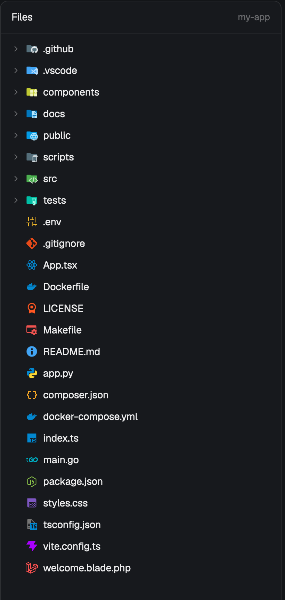

# herdr-files-icons

VS Code-style file and folder icons for the [Herdr](https://herdr.dev) Files pane.



- Full-color icons from [Material Icon Theme](https://github.com/material-extensions/vscode-material-icon-theme), matched the way VS Code does it: exact file name first (`package.json`, `Dockerfile`), then the longest extension (`.blade.php` before `.php`), then a generic file icon.
- Folders get their own icons by name (`src`, `tests`, `.github`, `components`) and switch to an open variant when expanded.
- Light appearance uses the theme's light variants.
- `.DS_Store` is hidden.

## Install

The mod replaces Herdr's Files panel, and Herdr's own layouts are read-only, so you point a personal layout at it.

1. Copy the mod into your Herdr home:

   ```sh
   git clone https://github.com/jmoren2/herdr-files-icons.git
   cp -R herdr-files-icons/mods/files-icons ~/.config/herdr-app/mods/
   ```

2. If you don't have a personal layout yet, clone the default one (Herdr switches to it):

   ```sh
   herdr-app do layout.clone '{"name":"main","as":"my-main"}'
   ```

3. In `~/.config/herdr-app/layouts/my-main.json`, find the block with `"id": "files"` and change its content to:

   ```json
   "content": { "mod": "files-icons" }
   ```

   Keep the `files` id: the tab bar's Files button targets it.

4. Check it loaded:

   ```sh
   herdr-app check ~/.config/herdr-app/mods/files-icons
   ```

To hide more names, add them to `HIDDEN` near the top of `mods/files-icons/main.js`.

To undo, change the block back to `"mod": "files"`, or switch layouts with `herdr-app do layout.switch --name main`.

## Notes

- This is a modified copy of Herdr's shipped Files mod (0.1.13), so it won't pick up Herdr's later changes to that mod. `RECIPE.md` describes the three changes, so you can rebuild it on a newer Herdr.
- The icons add about 5 MB.

## Licenses

- Icons: Material Icon Theme 5.39.0, MIT (`mods/files-icons/icons/LICENSE`).
- Files mod code: Herdr, Apache 2.0 (`mods/files-icons/LICENSE-herdr`).
