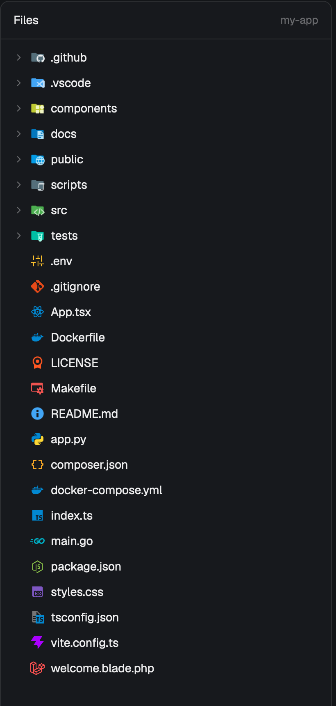

# Files (icons)

Herdr's Files panel with VS Code-style file and folder icons. Every row gets a full-color icon from Material Icon Theme, matched by exact file name, then extension, then folder name, the way VS Code's explorer does it. Folders switch to an "open" variant when expanded, and `.DS_Store` is hidden.

## What you see

- The same panel as Herdr's shipped Files mod: a 42px header ("Files", then the folder name on the right), then the tree, then the read-only file preview when a file is clicked.
- Each tree row is 28px tall: a 12px chevron for folders (theme `dim`), a 16px full-color icon, the name, and the git mark (A, M, D, U) on the right.
- Icons keep their own colors in both appearances. In a light appearance the theme's light variants are used where it has them.
- Until the icon table has loaded (a moment after the panel first shows), rows show Herdr's tinted file and folder icons.

## How it behaves

- Files: an exact, case-insensitive name match comes first (`package.json`, `Dockerfile`, `artisan`, `README.md`), then the longest extension (`blade.php` before `php`, `d.ts` before `ts`), then the generic file icon.
- Folders: matched by case-insensitive name (`src`, `scripts`, `infrastructure`, `.github`); an expanded folder uses the open icon for that name. Anything unknown gets the plain folder or open folder icon.
- Names in `HIDDEN` (`.DS_Store`) are dropped from every folder listing, locally and on remote machines.
- Everything else is Herdr's Files mod unchanged: lazy folder loading, the folder watch, git marks, previews.

## Built from

- `mods/files-icons/` is Herdr's shipped `files` mod (cloned from 0.1.13 with `mod.clone`, Apache-2.0, license in `LICENSE-herdr`) with three changes in `main.js`:
  1. `iconName(icons, name, dir, open)` does the lookup above and returns an icon name.
  2. `init` reads `${appHome()}/mods/files-icons/icons.json` with `readTextFile` in a `cx.spawn`, stores it on `this.icons` and calls `cx.notify()`.
  3. The row's icon is `image("mods/files-icons/icons/<name>.svg").size(16)` once `this.icons` is set, else the original tinted `svg(...)`. `loadFolder` filters entries through `HIDDEN`.
- `icons.json` is generated from Material Icon Theme 5.39.0's `dist/material-icons.json`: `{ file, folder, folderOpen, names, exts, folders, foldersOpen, light: { names, exts, folders, foldersOpen } }`, with values being icon names.
- `icons/` holds the 1,179 SVGs those names reference (about 4.7 MB), copied from the package's `icons/`, plus its MIT `LICENSE`.
- No network, no `exec` beyond the shipped mod's own folder listing and `git status`, and no file reads outside the mod's folder and the folders it browses.

## Install

The mod replaces the Files panel, so a layout has to point at it. Herdr's own layouts are read-only:

1. Copy `mods/files-icons/` into `~/.config/herdr-app/mods/`.
2. If you don't already have a personal layout: `herdr-app do layout.clone '{"name":"main","as":"my-main"}'`.
3. In that layout, change the block with `"id": "files"` to `"content": { "mod": "files-icons" }`. Keep the id: the tab bar's Files button targets it.
4. `herdr-app check ~/.config/herdr-app/mods/files-icons`.

## Watch out

- Material Icon Theme maps many languages only through VS Code language ids, not extensions. This build uses `fileExtensions` and `fileNames` only; the common ones (`ts`, `tsx`, `js`, `php`, `py`, `go`, `rs`, `json`, `md`) are in `fileExtensions` already, but a rare language may fall back to the generic icon.
- Use `image()`, not `svg()`: `svg()` tints the icon with the text color and loses its colors.
- `herdr-app check` writes `gpui-kit.d.ts` and `jsconfig.json` into the folder it checks; don't ship them.
- A clone of the Files mod doesn't receive Herdr's later changes to it. To rebuild on a newer Herdr, clone `files` again and repeat the three changes.
- `.env.aws` and similar names get the generic icon: the theme lists specific `.env.*` names only.

## Done when

- `herdr-app check` passes on `mods/files-icons`.
- With the layout pointing at it, `package.json` shows the Node icon, `README.md` the readme icon, `*.ts` the TypeScript icon and `*.blade.php` the Laravel icon.
- A folder named `src` shows the src folder icon, and expanding it switches to the open src icon.
- A folder containing `.DS_Store` doesn't list it.
- An unknown extension (`notes.xyz`) shows the generic file icon.
